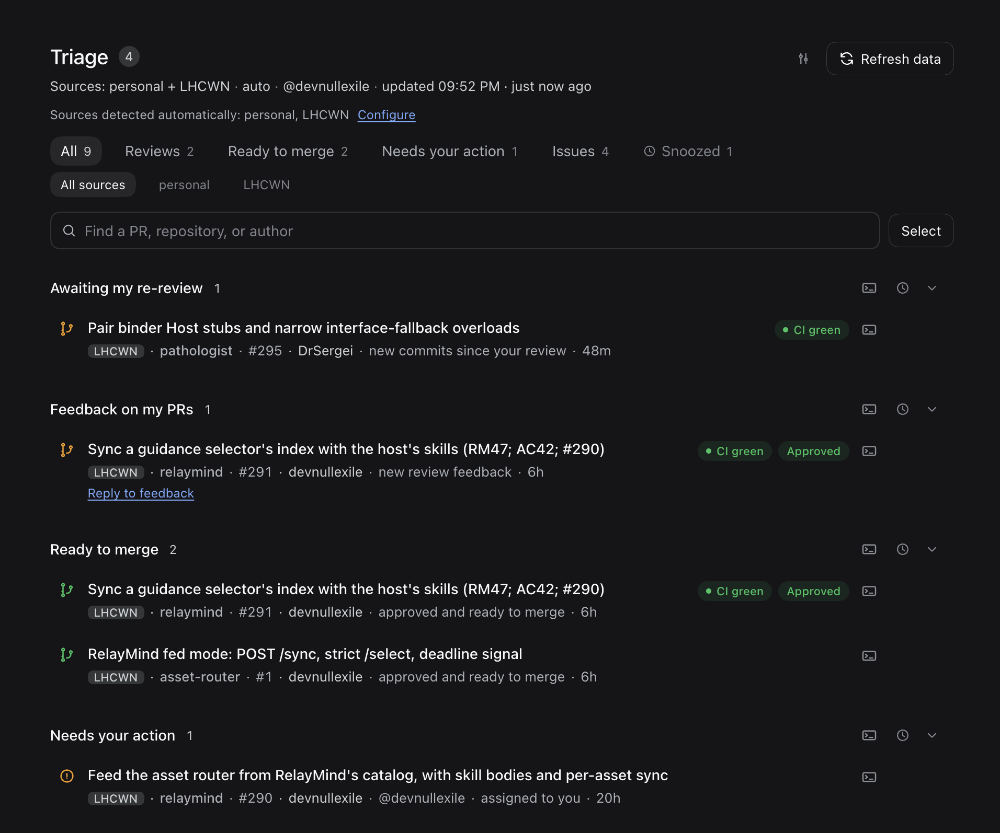
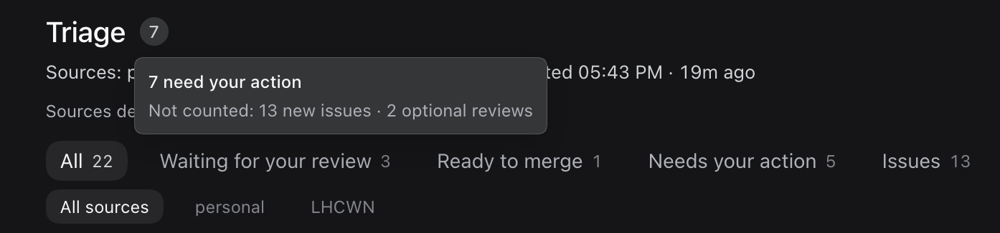
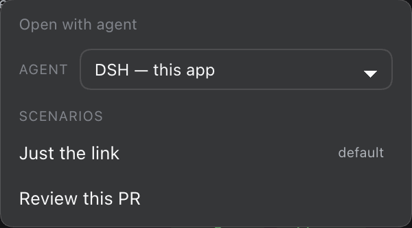
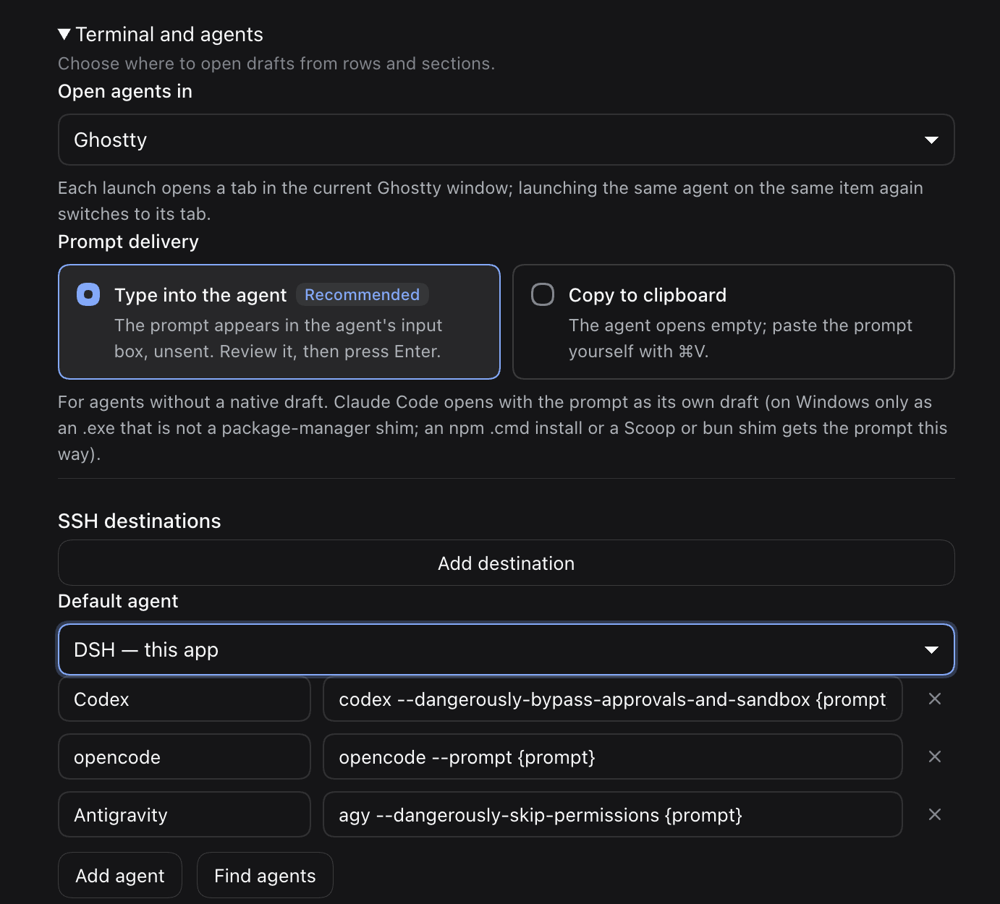

# Triage Desk

[](https://github.com/LHCWN/dsh-triage-desk/actions/workflows/check.yml)
[](https://www.npmjs.com/package/dsh-triage-desk)
[](LICENSE)
[](https://deepseek1024.com/plugins/LHCWN/dsh-triage-desk)
[](https://dsh-plugin.org/plugins/lhcwn/dsh-triage-desk)

A [DeepSeek Harness](https://github.com/deepseek-ai/deepseek-harness) (DSH)
plugin that answers one question every morning: **what needs me right now?** It
turns GitHub activity into a single inbox panel: reviews waiting on you, your
merge-ready PRs, threads that need an answer, failing CI, and new or assigned
issues. One click opens a coding agent on any item with a prepared prompt that
you review before sending. Everything runs locally through the GitHub CLI; the
plugin never stores or forwards a token.



[简体中文](README.zh.md) · [Reference](docs/REFERENCE.md) · [Architecture](docs/ARCHITECTURE.md) · [Changelog](CHANGELOG.md)

## What it shows

- **Reviews** shows whose turn it is on a PR. **Awaiting my review** lists direct or team requests. **Awaiting my re-review** offers a pass over changes and replies since your review when the author re-requests you (even on the same commit), pushes new commits, or replies to you. **Feedback on my PRs** lets you reply to comments or open the changed files to address requested changes.
- **Ready to merge** lists your mergeable PRs that have approval or need none. By default, checks must pass or be absent. A PR with failing checks appears under *CI is failing*. Once its checks pass, it enters *Ready to merge* on the next refresh if otherwise eligible.
- **Needs your action**: merge conflicts, assigned issues, and unanswered mentions.
- **CI is failing**: red checks on your PRs, on default branches you maintain, and on branches whose latest commit you authored in the last week.
- **New in your repositories**: unassigned issues from the last 30 days, kept out of the attention counter.
- **Snooze**: per row, per section, or a selection, until new activity, tomorrow, or next week.
- **Launch scenarios**: named, editable prompts that open a coding agent in the local clone or a new DSH chat. On upgrade, saved scenarios for **Needs your action** also apply to **Feedback on my PRs**. You can edit either binding in Settings.
- **Agent tool**: `triage_desk` gives a DSH agent the same snapshot and can open a terminal on request.
- **Sources and languages**: personal repositories plus up to 10 organizations; the panel follows the DSH language (English or Chinese).
- **Large organizations**: organizations as big as `llvm` load in a lighter mode instead of failing ([details](docs/REFERENCE.md#large-sources)).

The count next to *Triage* is what needs you; hover or focus it to see what it
leaves out.



Each feature is described in full in the [reference](docs/REFERENCE.md#inbox).

## Requirements

- DeepSeek Harness `0.2.2-rc.2` or newer.
- **GitHub only**: GitLab, Bitbucket, Gitea, and other code hosts are not supported.
- The GitHub CLI installed and signed in (`gh auth login`). Private repositories
  need the `repo` scope that `gh auth login` normally grants. Settings shows the
  connection and has a **Sign in to GitHub** button.
- Optional, for typing prompts into agents other than Claude Code: Python 3 on
  macOS and Linux, Windows 10 version 1809 or later on Windows (see
  [prompt delivery](docs/REFERENCE.md#prompt-delivery)).

## Install

Triage Desk is a DSH **bundle**: DSH installs it into a profile and loads it as a
plugin. There is no build step.

### From npm

```sh
dsh plugin --profile <profile> add dsh-triage-desk
```

`<profile>` is the profile you run: `web` for `dsh web`, `desktop` for the
Desktop app. Restart DSH, refresh the page, and open the **Triage** entry in the
sidebar. The first run auto-detects your organizations; the gear in the header
changes them. Plugin Manager can also install the package by name.

To update later, run the following and restart DSH:

```sh
dsh plugin --profile <profile> add dsh-triage-desk@latest
```

Removing the plugin (`dsh plugin --profile <profile> remove dsh-triage-desk`,
or **Remove** in Plugin Manager) keeps your saved settings in the profile, and
a reinstall picks them up again. To start from the defaults, see
[uninstall and saved settings](docs/REFERENCE.md#uninstall-and-saved-settings).

### From a local checkout (development)

1. Clone the repository.
2. In DSH open **Plugins → Add plugin** and pick the repository directory, or run
   `dsh plugin --profile <profile> add ./dsh-triage-desk` from its parent folder.
3. Open the **Triage** entry in the sidebar.

After editing the host half, quit and reopen DSH, then refresh the page; see
[local development](docs/DEV_LOCAL.md) for the reload rules.

## Launching agents

The terminal button on a row (or a section header) opens the launch menu: pick a
target (**DSH — this app** or an installed agent), then a scenario. A row
scenario opens the agent in the repository's local clone; a section scenario
launches one agent for the visible items in that group. The prompt is always
prepared but **not sent**. A line under the agent picker says where it opens and
how the prompt arrives, for example *Opens in Ghostty · prompt typed into the
input box, unsent*.

**Review 3 PRs** opens a draft for those three first reviews, even in **All**.
Re-reviews have their own action, and **Feedback on my PRs** offers replies.
The count follows your source filter and search, skips snoozed items and counts
each PR once. Rows marked **Optional review** are excluded by default. To pick
individual PRs, including optional ones, click **Select**, check the rows you
want, then open that group's terminal button. Its count shows how many you
picked in that group. If the prompt size limit drops any items, the draft and
notification show how many fit. If even the first item exceeds the limit, the
panel shows an error before opening a draft. Each terminal batch opens a fresh
tab or window.

Once you send it, the review scenarios post one GitHub review of inline comments
tagged `[P1]`–`[P3]`, and never approve. The fix and reply scenarios wait for your
OK before pushing or posting; triage only reports back. None of them add AI
attribution.



**Terminals.** Settings → *Terminal and agents* → **Open agents in** offers
*Automatic* or one of this platform's terminals; terminals that are not installed
are shown disabled.

| Platform | Terminals | Automatic |
|---|---|---|
| macOS | Terminal, iTerm2, Ghostty | iTerm2 when installed, otherwise Terminal |
| Linux | GNOME Terminal, Konsole, Xfce Terminal, Ghostty, kitty, Alacritty, xterm | `$TERMINAL`, then the first installed emulator |
| Windows | Windows Terminal, PowerShell window | Windows Terminal when installed |

iTerm2, Ghostty (macOS), GNOME Terminal, Konsole, Xfce Terminal, and Windows
Terminal open a tab; the others open a window per launch. A saved terminal that
is not installed falls back to Automatic, and the launch toast says so.

**Prompt delivery.** Claude Code opens with the prompt as its native
`--prefill` draft. On Windows that needs Claude Code as an `.exe`: an npm
install (a `.cmd` shim) is handled like the other agents, because `cmd.exe`
would not pass the prompt intact. So is an `.exe` shim from Scoop, bun,
Chocolatey, Volta, mise or proto, which can start a `.cmd`
([prompt delivery](docs/REFERENCE.md#prompt-delivery)). For every other agent,
Settings → **Prompt delivery** offers:

- **Type into the agent** (default, recommended): a small paste wrapper waits
  until the agent's input box is ready, then pastes the prompt into it without
  pressing Enter. Needs Python 3 on macOS (`xcode-select --install`) and Linux,
  or Windows 10 1809 or later; without it, launches use the clipboard and
  Settings and the toast say how to fix it.
- **Copy to clipboard**: the agent opens empty and you paste the prompt
  (⌘V on macOS, Ctrl+Shift+V in Linux terminals, Ctrl+V on Windows).

The toast names the agent and the terminal, for example *Codex opened in Ghostty
(/path): the prompt will appear in its input box, not sent — review it and press
Enter*.

**Agents.** By default a launch opens a new DSH chat with the prompt, and the
menu lists the coding agents installed on this machine: Claude Code, Codex,
opencode, Gemini CLI, Cursor Agent, Antigravity (`agy`), pi, Aider, Amp, Droid,
Goose, and Crush. Pick another default in Settings, or add your own command. A
command must contain `{prompt}` exactly once, unquoted, as its own argument or
right after a `--flag=`.

Agents start in **full access**, as Orca's default does: each built-in command
carries the agent's own flag for skipping permission prompts, such as
`codex --dangerously-bypass-approvals-and-sandbox` or
`agy --dangerously-skip-permissions`. A step a scenario asks the agent to
confirm first, such as pushing, then rests on the agent following its prompt. To
get the permission prompts back, remove the flag from the agent's command in
Settings ([flags per agent](docs/REFERENCE.md#agents)).

Details: [terminal launcher reference](docs/REFERENCE.md#terminal-launcher).

## Settings

The gear in the panel header opens Settings. A save usually applies to the
running plugin without restarting it, so the `triage_desk` tool stays
available while you save. The most used fields:

| Field | Default | Meaning |
|---|---|---|
| `orgs` | `[]` | Organizations to scan (at most 10); empty auto-detects them |
| `includePersonal` | `true` | Include your personal repositories |
| `refreshSeconds` | `1200` | Auto-refresh interval, 15–3600 s |
| `requireGreenChecks` | `true` | Turn off to allow otherwise eligible PRs with pending or failing checks in *Ready to merge*. PRs GitHub marks `BLOCKED` are excluded with either setting. |
| `defaultAgent` | `dsh` | Target selected in the launch menu: `dsh` (a new DSH chat) or an agent id |
| `terminal` | `auto` | Terminal for launches: `auto` or a terminal id |
| `promptDelivery` | `paste` | `paste` (type into the agent) or `clipboard` |

All fields, including agents, scenarios, and clone search, are in the
[configuration reference](docs/REFERENCE.md#configuration).



## Development

```sh
npm install     # dev dependencies and the pre-commit hook
npm run check   # lint, docs links, and all offline smokes
```

`npm run smoke:host` is a live check against GitHub that spends quota, so it is
not part of `npm run check`. Smokes, layout, and releasing:
[reference](docs/REFERENCE.md#development); module map:
[architecture](docs/ARCHITECTURE.md).

## License

[MIT](LICENSE)
